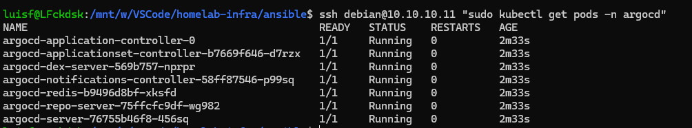
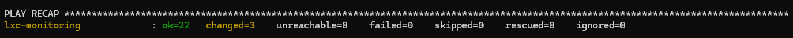
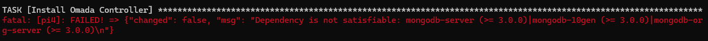

[Terraform had done its job](../proxmox-terraform/): three machines running on Proxmox, IPs allocated, SSH key injected. The next step was Ansible, which takes these raw VMs and transforms them into configured infrastructure: k3s running, NFS exporting volumes, PLG stack up, Pi4 with network services.

The code had been written since the trip. I knew there would be adjustments, but the idea was simple: run it, see what breaks, fix it, document it. Spoiler: quite a few things broke. Not for lack of planning, but because there is a real difference between writing code without hardware in front of you and running it in production.

##  Before running any playbook

Two problems appeared right at the beginning, before any ansible-playbook.

### The ansible.cfg being ignored

I ran the first ping to test connectivity and got the warning:

```
[WARNING]: Ansible is being run in a world writable directory, ignoring it as an ansible.cfg source
```

The project is located in `/mnt/w/` which is the Windows filesystem mounted on WSL. Ansible rejects the `ansible.cfg` from world-writable directories for security. The simplest way was to export the environment variable for each session:

```
export ANSIBLE_CONFIG=/mnt/w/VSCode/homelab-infra/ansible/ansible.cfg
```

### Different users per machine type

I had put `ansible_user: debian` in `vars.yml`. It works for VMs, where cloud-init creates the `debian` user. But Proxmox LXC doesn't go through cloud-init the same way, so it only comes with `root`. Moving the user to `inventory.ini` per host solves it:

```
k3s-node        ansible_host=10.10.10.11 ansible_user=debian
storage-server  ansible_host=10.10.10.12 ansible_user=debian
lxc-monitoring  ansible_host=10.10.10.13 ansible_user=root
```

With that, `ansible all -m ping` returned green on all three machines.

##  storage-server

First VM. The logic of running it in order makes sense because the k3s-node will mount NFS volumes that need to be exported beforehand.

### btrfs instead of ext4

When I created the disk manually in Proxmox, I chose btrfs: native snapshots per subvolume, transparent compression with zstd, and checksumming against silent corruption. It makes a difference for a disk that will store Immich photos and Nextcloud files. The playbook reflected ext4. I fixed it:

```yaml
- name: Create btrfs filesystem on storage device
  community.general.filesystem:
    fstype: btrfs
    dev: "{{ storage_device }}"
    opts: "-L data-sata"
    force: false

- name: Get UUID of storage device
  ansible.builtin.command:
    cmd: blkid -s UUID -o value {{ storage_device }}
  register: storage_uuid
  changed_when: false

- name: Mount storage with btrfs options via fstab
  ansible.builtin.mount:
    path: "{{ storage_mount }}"
    src: "UUID={{ storage_uuid.stdout }}"
    fstype: btrfs
    opts: defaults,compress=zstd,noatime
    state: mounted
```

The `force: false` ensures it won't reformat if a filesystem already exists. Mounting using UUID instead of the device path (`/dev/sdb`) avoids issues if the disk detection order changes between reboots.

### The right disk

First execution error: the playbook tried to format `/dev/sda` and `mkfs.btrfs` returned "device or resource busy". `/dev/sda` was the OS disk. The data disk was `/dev/sdb`. Inside Proxmox the disk appears one way, inside the VM the order can be different. Always double-check with `lsblk` inside the machine before pointing to any device in code.

### Missing btrfs-progs

```
Failed to find required executable "mkfs.btrfs" in paths
```

`mkfs.btrfs` comes from the `btrfs-progs` package which was not in the playbook's installation list. I added it along with `nfs-kernel-server`:

```yaml
- name: Install NFS package
  ansible.builtin.apt:
    name:
      - nfs-kernel-server
      - nfs-common
      - btrfs-progs
    state: present
```

With these tweaks, the playbook ran clean, the NFS reload handler fired at the end, and the exports showed up in `showmount -e localhost`.

##  k3s-node

Here the code was mostly correct, but I ran into an issue with ArgoCD.

### The CRD is too large

```
The CustomResourceDefinition "applicationsets.argoproj.io" is invalid:
metadata.annotations: Too long: may not be more than 262144 bytes
```

It's a known ArgoCD bug with conventional `kubectl apply`. The CRD exceeds the annotation size limit. The `--server-side` flag uses server-side apply and bypasses this:

```yaml
- name: Install ArgoCD
  ansible.builtin.command:
    cmd: kubectl apply -n argocd --server-side -f https://raw.githubusercontent.com/argoproj/argo-cd/stable/manifests/install.yaml
```

With this, the 7 ArgoCD pods came up without errors.



##  lxc-monitoring

This one was the most work. Not because of the complexity of what runs on it, but because LXC has restrictions that VMs don't.

### apt-key deprecated in Debian 13

```
Failed to find required executable "apt-key" in paths
```

`apt-key` was removed starting with Debian 12. The current way is to save the key in `/etc/apt/keyrings/` and reference it via `signed-by` in sources.list. The `apt_repository` Ansible module still tries to use `apt-key` internally, so the workaround was to use `copy` directly:

```yaml
- name: Add GPG key for Grafana
  ansible.builtin.get_url:
    url: https://apt.grafana.com/gpg.key
    dest: /etc/apt/keyrings/grafana.asc
    mode: '0644'

- name: Add Grafana repository
  ansible.builtin.copy:
    dest: /etc/apt/sources.list.d/grafana.list
    content: "deb [signed-by=/etc/apt/keyrings/grafana.asc] https://apt.grafana.com stable main\n"
    mode: '0644'
```

The same pattern was later applied to Docker on the Pi4.

### Tailscale doesn't start automatically on LXC

On VMs, the Tailscale installer already enables and starts `tailscaled` via systemd. On LXC this doesn't happen automatically, because containers have kernel access restrictions. The service started, but immediately crashed. The fix was to ensure the correct order:

```yaml
- name: Ensure Tailscale is running and enabled on boot
  ansible.builtin.service:
    name: tailscaled
    state: started
    enabled: true

- name: Connect to Tailscale with auth key
  ansible.builtin.command:
    cmd: tailscale up --authkey="{{ tailscale_auth_key }}"
  register: tailscale_up
  changed_when: tailscale_up.rc == 0
```

But it was still failing. The log revealed the real problem:

```
getLocalBackend error: CreateTUN("tailscale0") failed;
/dev/net/tun does not exist
```

Tailscale needs the TUN device to create the virtual network interface. In unprivileged LXC, this device is not available by default. I had to manually add it to the container config in Proxmox:

```
echo "lxc.cgroup2.devices.allow: c 10:200 rwm" >> /etc/pve/lxc/120.conf
echo "lxc.mount.entry: /dev/net/tun dev/net/tun none bind,create=file" >> /etc/pve/lxc/120.conf
pct reboot 120
```

The first line tells the kernel that the container can access the TUN device. The second mounts the host's `/dev/net/tun` inside the container. Without both together, it doesn't work.

`keyctl` also had to be enabled manually via `pct set`, because Proxmox doesn't allow changing feature flags via API unless you are `root@pam`. I added both to `lxc_monitoring.tf` as documentation of the desired state, with a comment explaining that the in-place apply will fail with 403 and must be done manually the first time.

### Loki 3.x with schema v13

The Loki config was written with v2.x in mind: `boltdb-shipper`, schema `v11`, `chunks_directory` field. The current version is 3.7.2 and changed quite a bit:

```yaml
schema_config:
  configs:
    - from: 2024-01-01
      store: tsdb           # was boltdb-shipper
      object_store: filesystem
      schema: v13           # was v11
      index:
        prefix: index_
        period: 24h

storage_config:
  tsdb_shipper:             # was boltdb_shipper
    active_index_directory: /var/loki/index
    cache_location: /var/loki/cache
  filesystem:
    directory: /var/loki/chunks   # was chunks_directory
```

Also, Loki 3.x requires a WAL directory for the ingester. Without it:

```
creating WAL folder at "/wal": mkdir wal: permission denied
```

I added it to the config and the directory creation loop:

```
ingester:
  wal:
    dir: /var/loki/wal
```

### Binary with wrong name

`unarchive` extracted the binary as `loki-linux-amd64` but the service calls `/usr/local/bin/loki`. A symlink solves it and is cleaner than renaming:

```yaml
- name: Create Loki symlink
  ansible.builtin.file:
    src: /usr/local/bin/loki-linux-amd64
    dest: /usr/local/bin/loki
    state: link
```

With all that, the three services came up: Grafana on `:3000`, Prometheus on `:9090`, Loki answering `ready` on `:3100` after about 15 seconds of ingester initialization.



##  Pi4

The Pi4 was the most uncertain part. I installed Raspberry Pi OS Lite 64-bit based on Debian 13 Trixie, which is the current version. Configured the user, enabled SSH, and copied the public key with `ssh-copy-id`.

### Omada and the MongoDB problem

The original playbook installed the Omada Controller directly via `.deb`. Omada depends on MongoDB, and MongoDB doesn't provide ARM64 binaries for Debian 13. I tested adding the repo manually, but the package simply doesn't exist for this architecture/distro combo.

The first idea was to move Omada to an LXC on Proxmox. I created `lxc_omada` via Terraform, separated the `omada.yml` playbook, and ran it. The service came up, but the LXC with 2GB of RAM sat at 98% memory usage just with MongoDB and Omada. That's not a healthy setup for something that needs to be available 24/7.



The solution was Docker. The `mbentley/omada-controller` image packages MongoDB and Java internally, without depending on anything from the host OS. I ran it on the Pi4 with a docker-compose managed by Ansible:

```yaml
services:
  omada-controller:
    image: mbentley/omada-controller:latest
    container_name: omada-controller
    restart: unless-stopped
    network_mode: host
    environment:
      - TZ=America/Sao_Paulo
      - MANAGE_HTTPS_PORT: 8043
    volumes:
      - /opt/omada/data:/opt/tplink/EAPController/data
      - /opt/omada/logs:/opt/tplink/EAPController/logs
    deploy:
      resources:
        limits:
          cpus: '1.0'
          memory: 2048M
        reservations:
          memory: 512M
```

The Pi4 with 8GB handles it well. I destroyed `lxc_omada` with `terraform destroy -target`, removed `lxc_omada.tf` and `omada.yml`, and moved Omada back to the Pi4 via Docker.

### UpSnap crashing due to missing $HOME

```
neither $XDG_CONFIG_HOME nor $HOME are defined
```

The UpSnap systemd service didn't have the `$HOME` variable defined. UpSnap uses PocketBase underneath, which needs to know where to create its config files. I added it to the service template:

```
[Service]
Environment=HOME=/root
ExecStart=/usr/local/bin/upsnap serve --http=0.0.0.0:{{ upsnap_port }} --dir=/mnt/data/upsnap
```

### NFS with root\_squash blocking access

UpSnap comes up but couldn't create a file on the NFS mount:

```
touch: cannot touch '/mnt/data/upsnap/test': Permission denied
```

NFS exports with `root_squash` by default, which converts the client's root to `nobody`. The Pi4 runs UpSnap as root, so writing is blocked. I fixed the export options in `vars.yml`:

```yaml
nfs_exports:
  - path: /mnt/data/upsnap
    clients: "{{ pi4_ip }}"
    options: rw,sync,no_subtree_check,no_root_squash
```

I ran `storage-server.yml` again, the NFS reload handler fired, and UpSnap started writing to the volume without errors.

##  The Tailscale pattern that stayed

One thing I standardized across all playbooks during troubleshooting: the Tailscale order. The original block had `creates:` as an idempotency guard on `tailscale up`, but this broke silently. The state file is created when the daemon starts, not when it authenticates. So on the second run, Ansible skipped the command and the node remained unauthenticated.

The pattern that stayed on all hosts:

```yaml
- name: Download and run Tailscale installation script
  ansible.builtin.shell:
    cmd: curl -fsSL https://tailscale.com/install.sh | sh
    creates: /usr/bin/tailscale

- name: Ensure Tailscale is running and enabled on boot
  ansible.builtin.service:
    name: tailscaled
    state: started
    enabled: true

- name: Connect to Tailscale with auth key
  ansible.builtin.command:
    cmd: tailscale up --authkey="{{ tailscale_auth_key }}"
  register: tailscale_up
  changed_when: tailscale_up.rc == 0
```

The `creates:` stays only on the script installation, not on `tailscale up`. Tailscale is idempotent by itself: if it's already authenticated with the same key, it does nothing.

##  Final result

Four configured machines, all services running:

| Machine | Services |
| --- | --- |
| `storage-server` | NFS, Node Exporter, Tailscale |
| `k3s-node` | k3s, ArgoCD, Node Exporter, Tailscale |
| `lxc-monitoring` | Prometheus, Grafana, Loki, Node Exporter, Tailscale |
| `Pi4` | Omada (Docker), MotionEye, UpSnap, Node Exporter, Tailscale |

Grafana is accessible on `:3000`, Prometheus is scraping metrics, ArgoCD is waiting for the `homelab-gitops` repo to start deploying. That's the next step: connect ArgoCD and spin up Nextcloud, Immich, Jellyfin, and Traefik via GitOps.

The code is on [homelab-infra](https://github.com/luisbrancher/homelab-infra).
