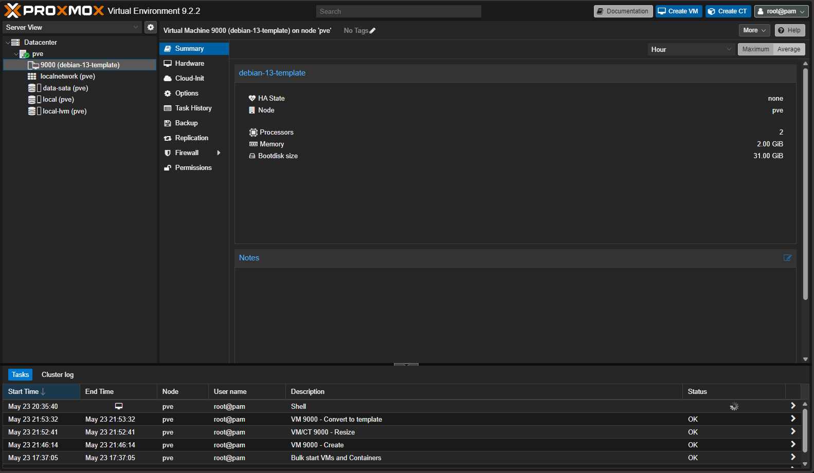
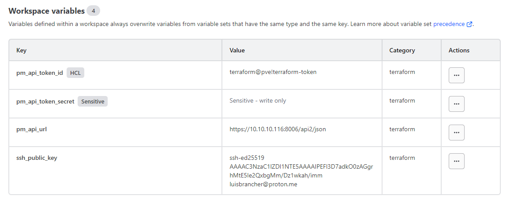
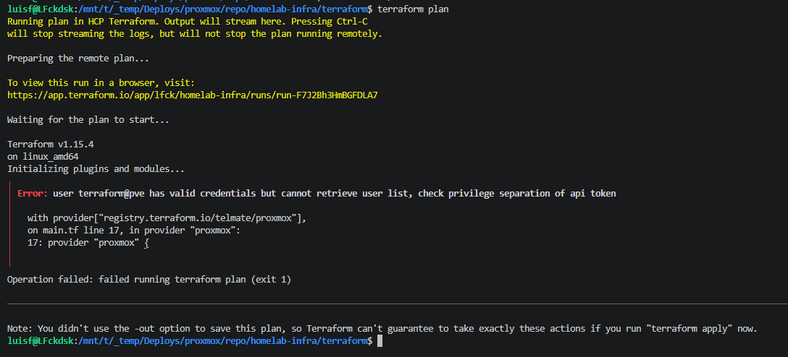
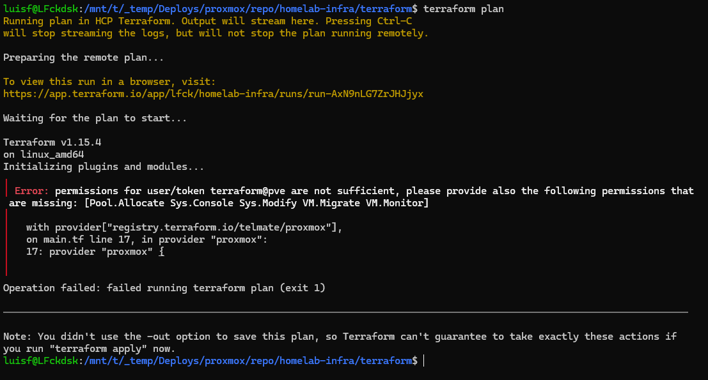
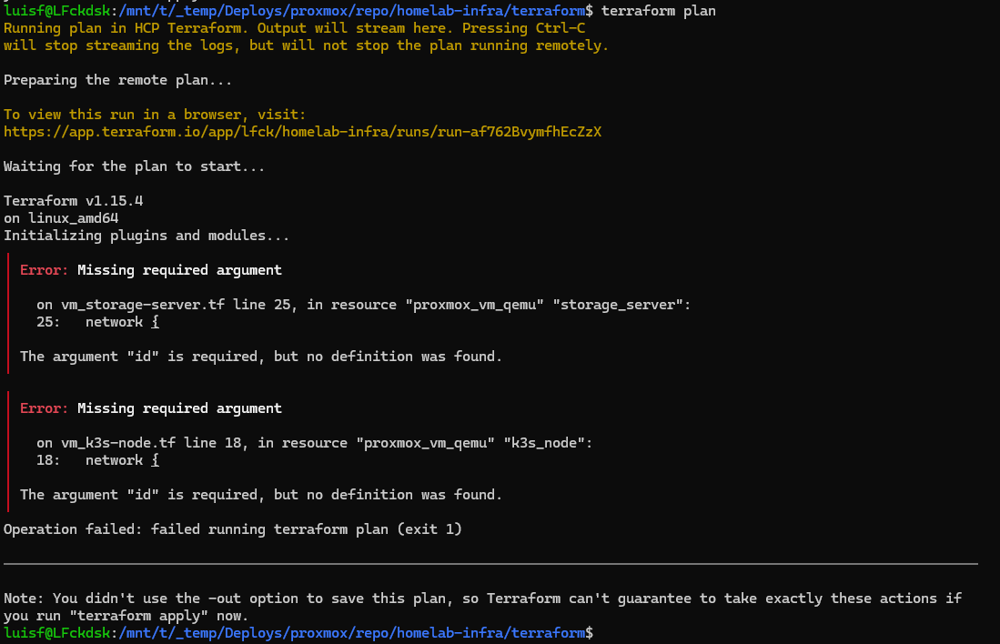
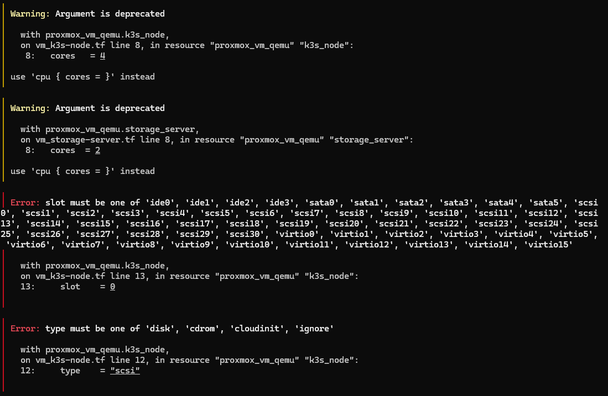
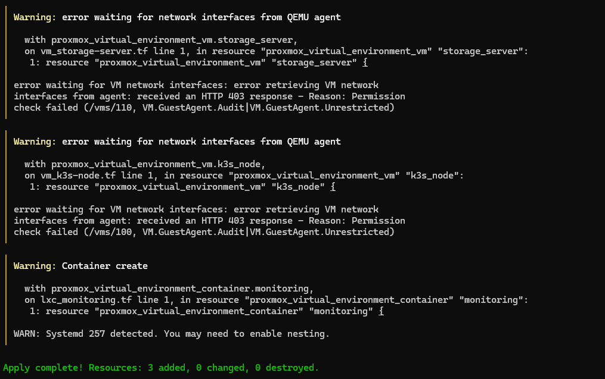
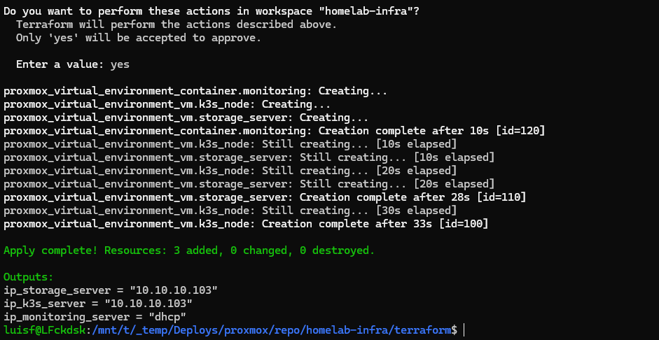

In previous articles I talked about the planning, the hardware, how I wrote the IaC code during the trip and the network configuration with OpnSense. This one is different: it's the first day getting hands-on with real hardware, running commands, seeing what breaks, and fixing it.

A contextual detail first: the hardware I planned to use was a fanless i5 1345U I had at home. Arriving from Brazil, the mini PC showed problems and I had to change the plan. I bought a Lenovo ThinkCentre to replace it, but while it doesn't arrive, I decided to deploy on the Ryzen 5800X that is still standing. The idea was to run everything on the temporary hardware, validate that the code works, debug what is needed, and when the Lenovo arrives, just repeat the process on clean hardware.

Two days later, I learned a lot of things that weren't in the plan.

##  Day 01: Proxmox, storage, and preparing everything for Terraform

### Installing Proxmox

Direct installation via ISO, nothing special here. Proxmox detected the disks and automatically configured LVM on the main NVMe. What I had to manually decide was what to do with the other disks.

My disk setup ended up like this:

- **NVMe** (465GB): Proxmox OS + VM disks via LVM (`local-lvm`)
- **SATA SSD** (931GB): persistent data for services
- **2x SATA HDDs** (931GB each): backups, ignored for now, later they will go via USB on the final hardware

### Configuring the SATA SSD storage

The SSD came with data from the previous ZimaOS. The first decision was to format it to start clean and avoid surprises.

I chose **btrfs** instead of ext4. Native snapshots per subvolume, transparent compression with zstd, and checksumming to detect silent corruption. For a disk that will store Immich photos and Nextcloud files, it makes a difference.

```
mkfs.btrfs -f -L data-sata /dev/sdc
mkdir -p /mnt/data
mount /dev/sdc /mnt/data
```

In fstab using UUID so it doesn't depend on the device letter, which can change:

```
echo 'UUID=c0954474-c348-446e-90d7-dbd521e7070e /mnt/data btrfs defaults,compress=zstd,noatime 0 0' >> /etc/fstab
mount -o remount /mnt/data
systemctl daemon-reload
```

Instead of dumping everything in the root of the disk, I created separate subvolumes per service. Each subvolume can have its own snapshot policy in the future:

```
btrfs subvolume create /mnt/data/nextcloud
btrfs subvolume create /mnt/data/immich
btrfs subvolume create /mnt/data/upsnap
btrfs subvolume create /mnt/data/backups
```

Then I registered the disk in Proxmox so it appears as a storage option:

```bash
pvesm add dir data-sata --path /mnt/data --content images,rootdir,backup
```

In the end, three pools were available:

| Name | Type | Use |
| --- | --- | --- |
| `local-lvm` | LVM-Thin (NVMe) | VM and LXC disks |
| `data-sata` | Directory (btrfs) | Persistent data |
| `local` | Directory | ISOs and templates |

### Creating the Terraform user in Proxmox

Terraform needs access to the Proxmox API. A good practice is to create a dedicated user with only the permissions it needs, without using root. I did this via the UI to familiarize myself with Proxmox:

- **Datacenter → Users → Add**: user `terraform`, realm `Proxmox VE authentication server`.
- **Datacenter → Roles → Create**: role `TerraformRole` with the necessary privileges.
- **Datacenter → Permissions → Add → User Permission**: associated `TerraformRole` to `terraform@pve` with path `/` and Propagate checked.
- **Datacenter → Permissions → API Tokens → Add**: token ID `terraform-token`, with **Privilege Separation unchecked**. This detail is important because with privsep active, the token is more restricted than the user even having the correct role.

The generated secret appears only once. I copied it to HCP Terraform.

### Creating the VM template (Debian 13 cloud-init)

I went straight with Debian 13 Trixie, it's been stable since June 2025, no reason to use 12.

```bash
cd /tmp
wget https://cloud.debian.org/images/cloud/trixie/latest/debian-13-genericcloud-amd64.qcow2
```

Here I had a forced 20-minute pause. The wget failed with `Temporary failure in name resolution`. OPNsense had no internet. I had moved it earlier and the cable was loose. Reconnected the cables, ping to 8.8.8.8 came back, wget worked. But it took me a while to realize the problem was just a loose cable.

With the image downloaded, the steps to create the template via CLI:

```bash
# creates base VM (ID 9000 is conventional for templates)
qm create 9000 --name "debian-13-template" --memory 2048 --cores 2 --net0 virtio,bridge=vmbr0

# imports disk to local-lvm
qm importdisk 9000 /tmp/debian-13-genericcloud-amd64.qcow2 local-lvm

# attaches the imported disk as boot disk
qm set 9000 --scsihw virtio-scsi-pci --scsi0 local-lvm:vm-9000-disk-0

# adds cloud-init drive, which injects user, SSH key, and network into cloned VMs
qm set 9000 --ide2 local-lvm:cloudinit

# configures boot order and serial, required for cloud-init to work
qm set 9000 --boot c --bootdisk scsi0
qm set 9000 --serial0 socket --vga serial0

# resizes the base disk to 31GB
qm resize 9000 scsi0 +28G

# converts to template
qm template 9000
```



### LXC template

This one doesn't need to be created, just downloaded:

```
pveam update
pveam download local debian-13-standard_13.1-2_amd64.tar.zst
```

### Configuring HCP Terraform

I created a `homelab` project and a `homelab-infra` workspace in HCP Terraform, with execution mode **CLI-driven** to run via terminal.

Four variables of type Terraform:

| Variable | Sensitive |
| --- | --- |
| `pm_api_token_id` → `terraform@pve!terraform-token` | ❌ |
| `pm_api_token_secret` → generated secret | ✅ |
| `pm_api_url` → `https://10.10.10.116:8006/api2/json` | ❌ |
| `ssh_public_key` → content of `id_ed25519.pub` | ❌ |

One mistake I made here: I accidentally marked `pm_api_token_id` as HCL. The `!` in the value (`terraform@pve!terraform-token`) breaks the HCL parser. Unchecking it solves it.



### Code tweaks before running

The code I wrote during the trip had a few things to tweak before running:

- Migrated auth from user/password to API token
- Added `cloud {}` block pointing to the HCP workspace
- Fixed VMIDs: template is 9000, VMs use 100, 110, 120
- Added explicit OS disk in each VM, the provider does not inherit from the template automatically
- Data disk for `storage-server`: 800G in `data-sata`
- Updated default `lxc_template` to Debian 13

### The cloud runner problem

First `terraform plan`, first error:

```
dial tcp 10.10.10.116:8006: connect: network is unreachable
```

HCP Terraform runs plans on HashiCorp's servers, which have no way to reach `10.10.10.116` on my local network.

The solution is the **HCP Terraform Agent**: a process that runs inside your network and pulls jobs from HCP via outbound connection, without needing to open any ports.

In HCP: **Settings → Agents → Create agent pool** → `homelab-agent`. Copy the token.

In the workspace: **Settings → General → Execution Mode** → Agent → `homelab-agent`.

I ran the agent via Docker on my PC:

```bash
docker run -d \
  --name tfc-agent \
  --restart unless-stopped \
  -e TFC_AGENT_TOKEN="TOKEN_HERE" \
  -e TFC_AGENT_NAME="homelab-agent" \
  hashicorp/tfc-agent:latest
```

With the agent registered, the plan passed the connectivity error and started hitting the Proxmox API for real.

### Debugging the plan

Error 1

```
user terraform@pve has valid credentials but cannot retrieve user list,
check privilege separation of api token
```



`Sys.Audit` was missing in `TerraformRole`:

```
pveum role modify TerraformRole -privs "Sys.Audit"
```

Error 2

```
permissions for user/token terraform@pve are not sufficient,
missing: [VM.Monitor]
```



The `telmate/proxmox` 3.x provider still required `VM.Monitor` which Proxmox 9 no longer has. Researching, I saw that version `3.0.2-rc07` solves this and that the community was migrating en masse to `bpg/proxmox`. I decided to test rc07 first to call it a day.

Error 3

```
The argument "id" is required, but no definition was found.
```



The 3.x provider changed the syntax of the network block. I added `id = 0`.

Error 4

```
slot must be one of 'ide0', 'scsi0'...
type must be one of 'disk', 'cdrom', 'cloudinit', 'ignore'
```



More syntax changes in 3.x: `slot = 0` became `slot = "scsi0"` and `type = "scsi"` became `type = "disk"`. Fixed both.

Green plan. Apply worked. VMs came up in Proxmox.

The output did not return IPs because the `telmate` provider depends on the QEMU Guest Agent to read the IP, and the VMs cloned from the template didn't have it installed. This was supposed to be solved by Ansible, but without an IP, Ansible couldn't connect. Chicken and egg.

I decided not to waste time fixing this in the old provider; it was time to migrate to `bpg/proxmox` anyway.

##  Day 02: migrating to bpg/proxmox and fixing the guest agent

### Why change providers

After two consecutive compatibility errors with Proxmox 9 in `telmate/proxmox`, I researched and confirmed what I was seeing in GitHub issues: the community migrated to `bpg/proxmox`. It's actively maintained, has native support for Proxmox 9 without permission hacks, and the documentation is much more complete.

It was worth keeping `telmate` to practice troubleshooting, but there was no reason to stick with it.

I destroyed the VMs and started the migration.

### Code changes

`bpg/proxmox` is a rewrite, not an update. Resource names, attributes, and blocks changed significantly.

**`main.tf`**: completely different auth syntax. The token becomes a single string in the format `user@realm!tokenid=secret`, and the provider needs an `ssh` block when using an API token:

```hcl
provider "proxmox" {
  endpoint  = var.pm_api_url
  api_token = "${var.pm_api_token_id}=${var.pm_api_token_secret}"
  insecure  = true

  ssh {
    agent    = true
    username = "root"
  }
}
```

The `ssh` block is necessary because some provider resources use SSH in addition to the REST API. With `agent = true` it uses the SSH agent key without needing a password. That's why I copied my `id_ed25519.pub` to Proxmox beforehand:

```
ssh-copy-id -i /mnt/c/Users/luisf/.ssh/id_ed25519.pub root@10.10.10.116
```

**VMs**: `proxmox_vm_qemu` became `proxmox_virtual_environment_vm`. Practically everything changed:

```hcl
resource "proxmox_virtual_environment_vm" "k3s_node" {
  name      = var.k3s_server
  node_name = var.proxmox_node
  vm_id     = 100

  clone {
    vm_id = var.vm_template_id  # number, not string
  }

  cpu {
    cores = 4
    type  = "host"
  }

  memory {
    dedicated = 8192
  }

  disk {
    interface    = "scsi0"
    size         = 50           # number, not "50G"
    datastore_id = var.storage_pool
  }

  network_device {
    bridge = var.network_bridge
    model  = "virtio"
  }

  initialization {
    ip_config {
      ipv4 {
        address = "dhcp"
      }
    }
    user_account {
      keys = [var.ssh_public_key]
    }
  }
}
```

**LXC**: `proxmox_lxc` became `proxmox_virtual_environment_container`:

```hcl
resource "proxmox_virtual_environment_container" "monitoring" {
  unprivileged = true
  node_name    = var.proxmox_node
  vm_id        = 120

  initialization {
    hostname = var.monitoring_server
    ip_config {
      ipv4 { address = "dhcp" }
    }
    user_account {
      keys = [var.ssh_public_key]
    }
  }

  operating_system {
    template_file_id = var.lxc_template
    type             = "debian"
  }

  features {
    nesting = true
  }
  ...
}
```

The `unprivileged = true` and `nesting = true` came from troubleshooting, more on that below.

**variables.tf**: I removed `vm_template` (string with name) and added `vm_template_id` (number). `bpg/proxmox` references the template by its numeric ID, not its name.

### Apply and warnings

The plan ran clean with the new provider. The apply brought up the 3 VMs/LXC in less than 30 seconds, but with 3 warnings.



Warnings 1 and 2

```
Permission check failed (/vms/110, VM.GuestAgent.Audit|VM.GuestAgent.Unrestricted)
```

`bpg/proxmox` tries to read the IP via guest agent right after creating the VMs. `TerraformRole` didn't have these permissions:

```
pveum role modify TerraformRole -privs "VM.GuestAgent.Audit VM.GuestAgent.Unrestricted"
```

Warning 3

```
WARN: Systemd 257 detected. You may need to enable nesting.
```

Debian 13 uses Systemd 257, which needs nesting enabled in LXC to manage services correctly. I tried adding `features { nesting = true }` in the code, but the apply failed:

```
Permission check failed (changing feature flags for privileged container
is only allowed for root@pam)
```

A privileged container only accepts feature changes via `root@pam`, not via API token. The solution is an unprivileged container with `unprivileged = true`, which in addition to solving the permission issue is the recommended security practice for LXC.

### The guest agent problem in the template

The apply was almost perfect, but the VM outputs returned `127.0.0.1` instead of the real IP. The provider was reading the first address from the guest agent, which is `lo`, not `ens18`. Simple fix in `outputs.tf`: `ipv4_addresses[0][0]` became `ipv4_addresses[1][0]`.

But the root problem was another: the VMs only had visible IPs via guest agent because the template already came with it installed. In the previous apply, the VMs didn't have a guest agent and the IPs didn't show up anywhere. I needed to fix this in the template.

1\. Convert the template back to a normal VM:

```bash
qm set 9000 --template 0
```

2\. Clone to a temporary VM:

```bash
qm clone 9000 999 --name "debian-13-temp"
qm start 999
```

3\. The chicken-and-egg problem

The cloned VM from the cloud-init template has no configured password, it only accepts login via SSH key. But without a guest agent, there's no visible IP, and without an IP, you can't connect via SSH. No login, no package installation.

Solution: inject a password directly into the disk while the VM is stopped:

```bash
qm stop 999
apt install -y libguestfs-tools  # no Proxmox host
virt-customize -a /dev/pve/vm-999-disk-0 --root-password password:yourpassword
qm start 999
```

4\. Configure network manually

Logged via console, the `ens18` interface had no IP. Cloud-init ran without a network datasource so it didn't create the interface configuration file. I manually did what it would have done:

```
cat > /etc/systemd/network/10-ens18.network << 'EOF'
[Match]
Name=ens18

[Network]
DHCP=yes
EOF
systemctl restart systemd-networkd
```

A few seconds later: `10.10.10.103` via DHCP.

5\. Enable guest agent in Proxmox and install:

```bash
# on Proxmox host
qm set 999 --agent enabled=1

# inside the VM
apt update && apt install -y qemu-guest-agent
systemctl start qemu-guest-agent
```

6\. Clean up and convert to template:

```bash
# inside the VM
rm /etc/systemd/network/10-ens18.network
cloud-init clean
poweroff

# on Proxmox host
qm destroy 9000
qm clone 999 9000 --name "debian-13-template" --full
qm template 9000
qm destroy 999
```

### Final apply

With the correct template, the final apply worked without warnings:

```
proxmox_virtual_environment_container.monitoring: Creation complete after 10s [id=120]
proxmox_virtual_environment_vm.storage_server: Creation complete after 26s [id=110]
proxmox_virtual_environment_vm.k3s_node: Creation complete after 27s [id=100]

Apply complete! Resources: 3 added, 0 changed, 0 destroyed.

Outputs:
ip_k3s_server        = "10.10.10.104"
ip_storage_server    = "10.10.10.105"
ip_monitoring_server = "dhcp"
```



Three machines running, IPs visible, complete pipeline working.

### 💡 Takeaways

**About providers**: versions matter. `telmate/proxmox` worked but was stuck in compatibility with Proxmox 9. Migrating to `bpg/proxmox` was the right decision and the code became cleaner.

**About cloud-init**: the cloud-init template only configures the network if it has a datasource. Without the data that Proxmox injects via the cloud-init drive, it runs but does nothing on the network. Good to know when you need to access a manually cloned VM.

**About RBAC**: least privilege is simple in theory, but in practice, you discover what's missing as errors pop up. `Sys.Audit`, `VM.GuestAgent.Audit`, `VM.GuestAgent.Unrestricted` were in no tutorials, they all appeared in the log.

**About HCP Terraform on a local network**: the agent is the right path for on-prem infrastructure. One Docker container to set up and you have a runner inside your network without opening any ports.

The next step is Ansible: grab the IPs generated by Terraform, put them in the inventory, and run playbooks to configure each VM from scratch: k3s, NFS, Tailscale, Prometheus, Grafana, Loki.

The code is on [homelab-infra](https://github.com/luisbrancher/homelab-infra).
