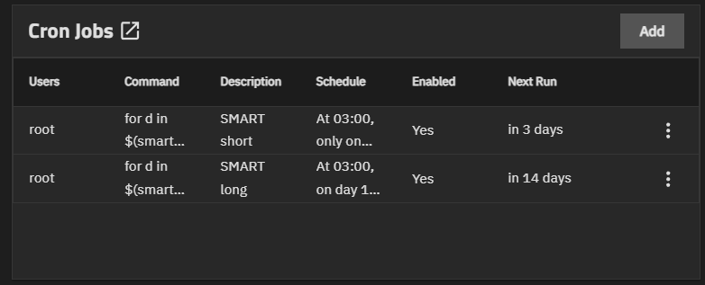

In the [previous post](../revisando-homelab/) I explained how I got to the homelab review and how I split the work into phases ahead of observability. Now the changes begin, and I'm starting with the disks, which is where I found the most things working by luck.

## Striped pools and no warnings

My NAS has two striped ZFS pools with two disks each. No redundancy, by choice: I prefer the space. The price is that one dead disk takes the whole pool with it, and I had nothing warning me. With no scrub alerts and no scheduled SMART, the first news of a bad disk would be the pool disappearing.

The first fix was the simplest. I created a Telegram bot and hooked it up as an alert service in TrueNAS itself. With the level set to Warning, it covers replication failures, degraded pools, scrub errors, and disks filling up.

For the SMART tests, my version of TrueNAS doesn't show the Periodic S.M.A.R.T. Tests card, so they became Cron Jobs running as root, a short test every Wednesday and a long one on the 15th of each month:

```bash
for d in $(smartctl --scan | awk '{print $1}'); do smartctl -t short $d; done
```



The cron job only fires the test, nobody looks at the result. For that I installed Scrutiny, which keeps each disk's history and sends notifications to the same Telegram.

## The boot SSD that started out "Failed"

On its first collection, Scrutiny marked the TrueNAS boot NVMe as Failed, with 121 Media Errors. Those are integrity errors the controller couldn't correct, so it wasn't a false alarm. It gave me a scare.

`smartctl -a` told a calmer story:

| Attribute | Value |
|---|---|
| Critical Warning | 0x00 |
| Available Spare | 100% |
| Percentage Used | 6% |
| Power On Hours | 12,867 |
| Unsafe Shutdowns | 53 |
| Error Information Log | No Errors Logged |
| Short and long self-tests | Completed without error |

6% wear, no spare blocks used, an empty error log, and both tests passing. Everything points to the errors being old, probably from this SSD's previous life, since I bought it used. The urgency dropped from "replace it now" to "keep an eye on it". The counter never goes back to zero, so Scrutiny will show Failed forever. What I need to watch is whether the number goes up.

I wrote down today's values to compare in a week or two and backed up the TrueNAS config outside the NAS. If this disk dies, the data stays on the pools, but the NAS stops, and the cluster's NFS with it. With the config file, it's just a matter of reinstalling and bringing it back up.

## The disk that was only right by accident

This one bothered me more. In the `k3s-node` playbook, Jellyfin's media disk looked like this:

```yaml
- name: Mount media SSD persistently
  ansible.posix.mount:
    path: /mnt/media-ssd
    src: /dev/sda1
```

Except that on the VM, `sda` is the OS disk. The media disk is `sdb`. I had already fallen for this twice and fixed the fstab by hand, without carrying the fix back to the code. If I ran that playbook again, it would rewrite the fstab, and on the next reboot `/mnt/media-ssd` would become the system root itself. Linux mounts the same ext4 twice without complaining, and Jellyfin would scan all of `/`.

The code now uses the `/dev/disk/by-id/` path, which comes from the VM's slot and doesn't change when `sda` and `sdb` swap order. The mount uses the UUID, read on the spot with `blkid`. If I hardcoded the UUID, recreating the VM would break everything, because the new disk would have a different one.

There was a second risk left: if the SSD doesn't mount, Jellyfin writes to the empty folder under the mount point and fills the OS disk without anyone noticing. `chattr +i` on that folder solves it, because the write then fails. The problem is that the folder is hidden by the mount itself, and I didn't want to unmount anything. The trick was a bind mount of `/`, which shows what's underneath:

```bash
tmp=$(mktemp -d)
mount --bind / "$tmp"
trap 'umount "$tmp"; rmdir "$tmp"' EXIT
chattr +i "$tmp/mnt/media-ssd"
```

No unmounting and no stopping Jellyfin. The playbook version also checks with `lsattr` whether the flag is already there.

The review also suggested a k3s drop-in with `RequiresMountsFor=/mnt/media-ssd`, and I ended up dropping it. Without `nofail` in the fstab, a missing SSD at boot already sends the VM into emergency mode, so it adds nothing there. After boot, a failure on this disk would take down all of k3s, Immich and Nextcloud included, because of a disk full of movies. It wasn't worth the trade.

### Running it again is the test

I ran everything with `--check --diff` before applying, and that caught two problems.

The first showed up in the dry run: the mount point task was going to change the permissions from 775 to 755. `/mnt/media-ssd` is really two folders at the same path, the OS's empty one and the SSD's root on top of it, and the task was seeing the top one. The `mode: '0755'` in the code didn't match what I had left on the machine. One more bit of drift. I removed the `mode`, since the task only needs to make sure the folder exists.

The second came after applying. The second run should have given `changed=0` and gave `changed=1`. The bug was in this line, which Claude wrote and I approved without noticing:

```yaml
changed_when: "'changed' in media_ssd_immutable.stdout"
```

The script prints `changed` or `unchanged`, and `unchanged` contains `changed`. The VM was fine, only the report was lying. A `changed` that always shows up breaks nothing today, but it would teach me to ignore that signal. Switching to `== 'changed'` fixed it, and the next run gave `changed=0`.

## 48GB stuck in the thin pool

Both of the VM's disks live on LVM-Thin, with `discard=ignore`. I misread this at first: I thought the VM didn't know what had been deleted and that we'd only be correcting the number it displayed. It's the opposite. The VM knows, and `df` is right. The one that never finds out is Proxmox, because the "these blocks are free" notice dies along the way. The block stays occupied on the physical SSD.

With Jellyfin's download, watch, and delete cycle, the pool only grows. When it hits 100%, the VM locks up with I/O errors, even though it thinks it has plenty of space.

The Terraform change is small:

```diff
   disk {
     interface    = "scsi1"
     size         = 220
     datastore_id = "media-ssd"
+    discard      = "on"
+    ssd          = true
   }
```

The `apply` wasn't enough, and I didn't know that. Proxmox saved the new configuration and the VM kept running with the old one:

```text
cur scsi1: media-ssd:vm-100-disk-0,...,discard=ignore,...,ssd=0
new scsi1: media-ssd:vm-100-disk-0,...,discard=on,...,ssd=1
```

A reboot from inside the VM doesn't solve it either, because the QEMU process stays the same. It has to be shut down and started from the host:

```bash
qm shutdown 100 --timeout 180 && qm start 100
```

After that, `discard` only handles what gets deleted from then on. On the VM, `/` already mounts with `discard`, but the media disk depends on the weekly `fstrim.timer`, which I made sure of in Ansible. For what was already stuck, I ran `fstrim -av` on the VM and `pct fstrim 120` on the host for the monitoring LXC, since a container doesn't get `discard` the way a VM does. The result in `lvs`:

| Volume | Before | After | Reclaimed |
|---|---|---|---|
| VM OS (50G) | 98.73% | 56.39% | ~21GB |
| VM media (220G) | 19.95% | 8.07% | ~26GB |
| Monitoring LXC (20G) | 31.07% | 25.83% | ~1GB |

Almost 48GB, with no symptoms at all until I looked. `fstrim` did report "202.2 GiB trimmed" on the media disk, but that number is all the free space it announced, including what was never used. The real gain is the drop in `lvs`.

That output showed something else: the media virtual disk is 220G and the pool hosting it is 218.97G. If I actually fill the media disk, the pool runs out before the filesystem does. I made a note not to go past about 200G.

## How much disk the OS needs

The OS disk was at 59%, and nine days earlier it had been at 49%. My idea was to grow it by a lot, since the data lives on TrueNAS and this disk would be system only. I measured first:

| What takes up space | Size |
|---|---|
| Container images | 19G |
| Journal logs | 3.9G |
| Pod data | 2.9G |
| Immich and Nextcloud databases | 1.6G |

It wasn't only system. The databases live here, and the images are what grows the most. I settled on 100G rather than 150G, for two reasons. k3s only cleans up old images at around 85% usage, so a bigger disk piles up more junk before cleaning. And 150G would push the sum of the virtual disks past the size of the pool. Proxmox only grows disks, it never shrinks them, and growing again takes a few minutes, so there's no reason to overdo it now.

Growing touches three layers, and each has its own command:

```bash
terraform apply                   # virtual disk
sudo growpart /dev/sda 1          # partition
sudo resize2fs /dev/sda1          # filesystem
```

Before running it, `growpart --dry-run` showed that the partition start and the UUID wouldn't change. All of it happened with the VM on, with no service downtime, and `/` went from 59% to 30%.

## What's still open

I still need to compare the boot SSD's counters with the values I wrote down, schedule the LXC's `pct fstrim`, and move the Jellyfin library to a subfolder, because today it points at the root of the volume.

### 💡 Takeaways

**On SMART**: a test nobody looks at warns nobody, and a Failed on its own isn't a diagnosis. The 121 Media Errors scared me, but what I'll be tracking is whether the counter goes up.

**On drift**: a fix made by hand and never carried back to the code is still a problem, just a hidden one. The fstab was right on the machine and wrong in the playbook, and the next run would have undone the fix.

**On idempotency**: `--check --diff` beforehand and a second run afterwards catch different things. The dry run found the permission that was about to change, and the second run found the `changed_when` that was lying.

**On thin provisioning**: the VM's `df` doesn't tell you how much of the pool is occupied, `lvs` does. And the new `discard` only took effect after shutting the VM down and starting it from the host.

**On sizing disks**: measuring first changed the decision. I thought the OS disk was system only, but the databases live there. Since it can grow later and can't shrink, I went with the smallest size that solved the problem.
