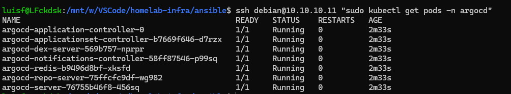
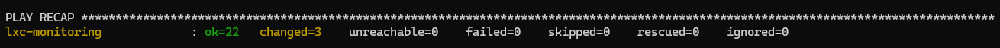
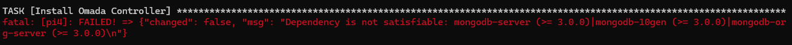

[O Terraform tinha feito seu trabalho](../proxmox-terraform/): três máquinas rodando no Proxmox, IPs alocados, chave SSH injetada. O próximo passo era o Ansible, que pega essas VMs cruas e transforma em infraestrutura configurada: k3s rodando, NFS exportando volumes, PLG stack no ar, Pi4 com os serviços de rede.

O código estava escrito desde a viagem. Sabia que ia ter ajuste, mas a ideia era simples: roda, vê o que quebra, corrige, documenta. Spoiler: quebrou bastante coisa. Não por falta de planejamento, mas porque tem uma diferença real entre escrever código sem hardware na frente e rodar ele em produção.

##  Antes de rodar qualquer playbook

Dois problemas apareceram logo no começo, antes de qualquer ansible-playbook.

### O ansible.cfg sendo ignorado

Rodei o primeiro ping pra testar conectividade e tomei o warning:

```
[WARNING]: Ansible is being run in a world writable directory, ignoring it as an ansible.cfg source
```

O projeto fica em `/mnt/w/` que é o filesystem do Windows montado no WSL. O Ansible rejeita o `ansible.cfg` de diretórios world-writable por segurança. O caminho mais simples foi exportar a variável de ambiente pra cada sessão:

```
export ANSIBLE_CONFIG=/mnt/w/VSCode/homelab-infra/ansible/ansible.cfg
```

### Users diferentes por tipo de máquina

Eu tinha colocado `ansible_user: debian` no `vars.yml`. Funciona pra VMs, onde o cloud-init cria o usuário `debian`. Mas o LXC do Proxmox não passa por cloud-init da mesma forma, então vem só com `root`. Mover o user pro `inventory.ini` por host resolve:

```
k3s-node        ansible_host=10.10.10.11 ansible_user=debian
storage-server  ansible_host=10.10.10.12 ansible_user=debian
lxc-monitoring  ansible_host=10.10.10.13 ansible_user=root
```

Com isso, `ansible all -m ping` voltou verde nas três máquinas.

##  storage-server

Primeira VM. A lógica de rodar em ordem faz sentido porque o k3s-node vai montar volumes NFS que precisam estar exportados antes.

### btrfs no lugar de ext4

Quando fiz o disco na mão no Proxmox, escolhi btrfs: snapshots nativos por subvolume, compressão com zstd e checksumming contra corrupção silenciosa. Faz diferença pra um disco que vai guardar fotos do Immich e arquivos do Nextcloud. O playbook refletia ext4. Corrigi:

```yaml
- name: Create btrfs filesystem on storage device
  community.general.filesystem:
    fstype: btrfs
    dev: "{{ storage_device }}"
    opts: "-L data-sata"
    force: false

- name: Get UUID of storage device
  ansible.builtin.command:
    cmd: blkid -s UUID -o value {{ storage_device }}
  register: storage_uuid
  changed_when: false

- name: Mount storage with btrfs options via fstab
  ansible.builtin.mount:
    path: "{{ storage_mount }}"
    src: "UUID={{ storage_uuid.stdout }}"
    fstype: btrfs
    opts: defaults,compress=zstd,noatime
    state: mounted
```

O `force: false` garante que ele não reformate se já existir filesystem. A montagem usando UUID em vez do device path (`/dev/sdb`) evita problemas se a ordem de detecção dos discos mudar entre reboots.

### O disco certo

Primeiro erro de execução: o playbook tentou formatar `/dev/sda` e o `mkfs.btrfs` retornou "device or resource busy". O `/dev/sda` era o disco do sistema operacional. O disco de dados era o `/dev/sdb`. Dentro do Proxmox o disco aparece de um jeito, dentro da VM a ordem pode ser diferente. Sempre confirmar com `lsblk` dentro da máquina antes de apontar qualquer device no código.

### btrfs-progs faltando

```
Failed to find required executable "mkfs.btrfs" in paths
```

O `mkfs.btrfs` vem do pacote `btrfs-progs` que não estava na lista de instalações do playbook. Adicionei junto com o `nfs-kernel-server`:

```yaml
- name: Install NFS package
  ansible.builtin.apt:
    name:
      - nfs-kernel-server
      - nfs-common
      - btrfs-progs
    state: present
```

Com esses ajustes o playbook rodou limpo, handler de reload do NFS disparou no final e os exports apareceram no `showmount -e localhost`.

##  k3s-node

Aqui o código estava mais certo, mas esbarrei no ArgoCD.

### O CRD grande demais

```
The CustomResourceDefinition "applicationsets.argoproj.io" is invalid:
metadata.annotations: Too long: may not be more than 262144 bytes
```

É um bug conhecido do ArgoCD com `kubectl apply` convencional. O CRD ultrapassa o limite de tamanho das annotations. A flag `--server-side` usa server-side apply e contorna isso:

```yaml
- name: Install ArgoCD
  ansible.builtin.command:
    cmd: kubectl apply -n argocd --server-side -f https://raw.githubusercontent.com/argoproj/argo-cd/stable/manifests/install.yaml
```

Com isso os 7 pods do ArgoCD subiram sem erro.



##  lxc-monitoring

Esse foi o mais trabalhoso. Não pela complexidade do que roda nele, mas porque LXC tem restrições que VMs não têm.

### apt-key deprecated no Debian 13

```
Failed to find required executable "apt-key" in paths
```

O `apt-key` foi removido a partir do Debian 12. A forma atual é salvar a chave em `/etc/apt/keyrings/` e referenciar pelo `signed-by` no sources.list. O módulo `apt_repository` do Ansible ainda tenta usar `apt-key` internamente, então a saída foi usar `copy` diretamente:

```yaml
- name: Add GPG key for Grafana
  ansible.builtin.get_url:
    url: https://apt.grafana.com/gpg.key
    dest: /etc/apt/keyrings/grafana.asc
    mode: '0644'

- name: Add Grafana repository
  ansible.builtin.copy:
    dest: /etc/apt/sources.list.d/grafana.list
    content: "deb [signed-by=/etc/apt/keyrings/grafana.asc] https://apt.grafana.com stable main\n"
    mode: '0644'
```

O mesmo padrão aplicado depois no Docker do Pi4.

### Tailscale não sobe automaticamente no LXC

Nas VMs, o installer do Tailscale já habilita e inicia o `tailscaled` via systemd. No LXC não acontece automaticamente, porque containers têm restrições de acesso ao kernel. O serviço era iniciado, mas caía imediatamente. O fix foi garantir a ordem correta:

```yaml
- name: Ensure Tailscale is running and enabled on boot
  ansible.builtin.service:
    name: tailscaled
    state: started
    enabled: true

- name: Connect to Tailscale with auth key
  ansible.builtin.command:
    cmd: tailscale up --authkey="{{ tailscale_auth_key }}"
  register: tailscale_up
  changed_when: tailscale_up.rc == 0
```

Mas mesmo assim continuava falhando. O log revelou o problema real:

```
getLocalBackend error: CreateTUN("tailscale0") failed;
/dev/net/tun does not exist
```

O Tailscale precisa do dispositivo TUN pra criar a interface de rede virtual. Em LXC unprivileged, esse dispositivo não está disponível por padrão. Precisei adicionar manualmente na config do container no Proxmox:

```
echo "lxc.cgroup2.devices.allow: c 10:200 rwm" >> /etc/pve/lxc/120.conf
echo "lxc.mount.entry: /dev/net/tun dev/net/tun none bind,create=file" >> /etc/pve/lxc/120.conf
pct reboot 120
```

A primeira linha diz ao kernel que o container pode acessar o dispositivo TUN. A segunda monta o `/dev/net/tun` do host dentro do container. Sem as duas juntas não funciona.

O `keyctl` também precisou ser habilitado manualmente via `pct set`, porque o Proxmox não aceita alteração de feature flags via API sem ser `root@pam`. Adicionei os dois no `lxc_monitoring.tf` como documentação do estado desejado, com comentário explicando que o apply in-place vai falhar com 403 e precisa ser feito manualmente na primeira vez.

### Loki 3.x com schema v13

O config do Loki estava escrito pensando na v2.x: `boltdb-shipper`, schema `v11`, campo `chunks_directory`. A versão atual é a 3.7.2 e mudou bastante:

```yaml
schema_config:
  configs:
    - from: 2024-01-01
      store: tsdb           # era boltdb-shipper
      object_store: filesystem
      schema: v13           # era v11
      index:
        prefix: index_
        period: 24h

storage_config:
  tsdb_shipper:             # era boltdb_shipper
    active_index_directory: /var/loki/index
    cache_location: /var/loki/cache
  filesystem:
    directory: /var/loki/chunks   # era chunks_directory
```

Além disso, o Loki 3.x exige um diretório WAL pro ingester. Sem ele:

```
creating WAL folder at "/wal": mkdir wal: permission denied
```

Adicionei no config e no loop de criação de diretórios:

```
ingester:
  wal:
    dir: /var/loki/wal
```

### Binário com nome errado

O unarchive extraiu o binário como `loki-linux-amd64` mas o serviço chama `/usr/local/bin/loki`. Symlink resolve e é mais limpo que renomear:

```yaml
- name: Create Loki symlink
  ansible.builtin.file:
    src: /usr/local/bin/loki-linux-amd64
    dest: /usr/local/bin/loki
    state: link
```

Com tudo isso, os três serviços subiram: Grafana em `:3000`, Prometheus em `:9090`, Loki respondendo `ready` em `:3100` depois de uns 15 segundos de inicialização do ingester.



##  Pi4

O Pi4 era a parte mais incerta. Instalei o Raspberry Pi OS Lite 64-bit baseado em Debian 13 Trixie, que é a versão atual. Configurei o usuário, habilitei SSH e copiei a chave pública com `ssh-copy-id`.

### Omada e o problema do MongoDB

O playbook original instalava o Omada Controller direto via `.deb`. O Omada depende do MongoDB, e o MongoDB não disponibiliza binários ARM64 pra Debian 13. Testei adicionar o repo manualmente, mas o pacote simplesmente não existe pra essa combinação de arquitetura e distro.

A primeira ideia foi mover o Omada pra um LXC no Proxmox. Criei o `lxc_omada` via Terraform, separei o playbook `omada.yml` e rodei. O serviço subiu, mas o LXC com 2GB de RAM ficou em 98% de memória apenas com MongoDB e Omada. Não é uma configuração saudável pra algo que precisa ficar disponível 24/7.



A solução foi o Docker. A imagem `mbentley/omada-controller` empacota o MongoDB e o Java internamente, sem dependência de nada do sistema operacional host. Rodei no Pi4 com um docker-compose gerenciado pelo Ansible:

```yaml
services:
  omada-controller:
    image: mbentley/omada-controller:latest
    container_name: omada-controller
    restart: unless-stopped
    network_mode: host
    environment:
      - TZ=America/Sao_Paulo
      - MANAGE_HTTPS_PORT: 8043
    volumes:
      - /opt/omada/data:/opt/tplink/EAPController/data
      - /opt/omada/logs:/opt/tplink/EAPController/logs
    deploy:
      resources:
        limits:
          cpus: '1.0'
          memory: 2048M
        reservations:
          memory: 512M
```

O Pi4 com 8GB aguenta bem. Destruí o `lxc_omada` com `terraform destroy -target`, removi o `lxc_omada.tf` e o `omada.yml`, e voltei o Omada pro Pi4 via Docker.

### UpSnap travando por falta de $HOME

```
neither $XDG_CONFIG_HOME nor $HOME are defined
```

O serviço systemd do UpSnap não tinha variável `$HOME` definida. O UpSnap usa o PocketBase por baixo, que precisa saber onde criar os arquivos de configuração. Adicionei no template do service:

```
[Service]
Environment=HOME=/root
ExecStart=/usr/local/bin/upsnap serve --http=0.0.0.0:{{ upsnap_port }} --dir=/mnt/data/upsnap
```

### NFS com root\_squash bloqueando

O UpSnap sobe mas não conseguia criar arquivo no mount NFS:

```
touch: cannot touch '/mnt/data/upsnap/test': Permission denied
```

O NFS exporta com `root_squash` por padrão, que converte o root do cliente para `nobody`. O Pi4 roda o UpSnap como root, então a escrita é bloqueada. Corrigi nas opções de export no `vars.yml`:

```yaml
nfs_exports:
  - path: /mnt/data/upsnap
    clients: "{{ pi4_ip }}"
    options: rw,sync,no_subtree_check,no_root_squash
```

Rodei o `storage-server.yml` de novo, o handler de reload do NFS disparou, e o UpSnap passou a escrever no volume sem erro.

##  O padrão do Tailscale que ficou

Uma coisa que padronizei em todos os playbooks durante o troubleshooting: a ordem do Tailscale. O bloco original tinha `creates:` como guard de idempotência no `tailscale up`, mas isso quebrava silenciosamente. O arquivo de state é criado quando o daemon inicia, não quando autentica. Então na segunda execução o Ansible pulava o comando e o nó ficava desautenticado.

O padrão que ficou em todos os hosts:

```yaml
- name: Download and run Tailscale installation script
  ansible.builtin.shell:
    cmd: curl -fsSL https://tailscale.com/install.sh | sh
    creates: /usr/bin/tailscale

- name: Ensure Tailscale is running and enabled on boot
  ansible.builtin.service:
    name: tailscaled
    state: started
    enabled: true

- name: Connect to Tailscale with auth key
  ansible.builtin.command:
    cmd: tailscale up --authkey="{{ tailscale_auth_key }}"
  register: tailscale_up
  changed_when: tailscale_up.rc == 0
```

O `creates:` fica só na instalação do script, não no `tailscale up`. O Tailscale é idempotente por si só: se já estiver autenticado com a mesma key, não faz nada.

##  Resultado final

Quatro máquinas configuradas, todos os serviços rodando:

| Máquina | Serviços |
| --- | --- |
| `storage-server` | NFS, Node Exporter, Tailscale |
| `k3s-node` | k3s, ArgoCD, Node Exporter, Tailscale |
| `lxc-monitoring` | Prometheus, Grafana, Loki, Node Exporter, Tailscale |
| `Pi4` | Omada (Docker), MotionEye, UpSnap, Node Exporter, Tailscale |

O Grafana está acessível em `:3000`, o Prometheus raspando métricas, o ArgoCD aguardando o repositório `homelab-gitops` pra começar a fazer deploys. Esse é o próximo passo: conectar o ArgoCD e subir Nextcloud, Immich, Jellyfin e Traefik via GitOps.

O código está no [homelab-infra](https://github.com/luisbrancher/homelab-infra).
