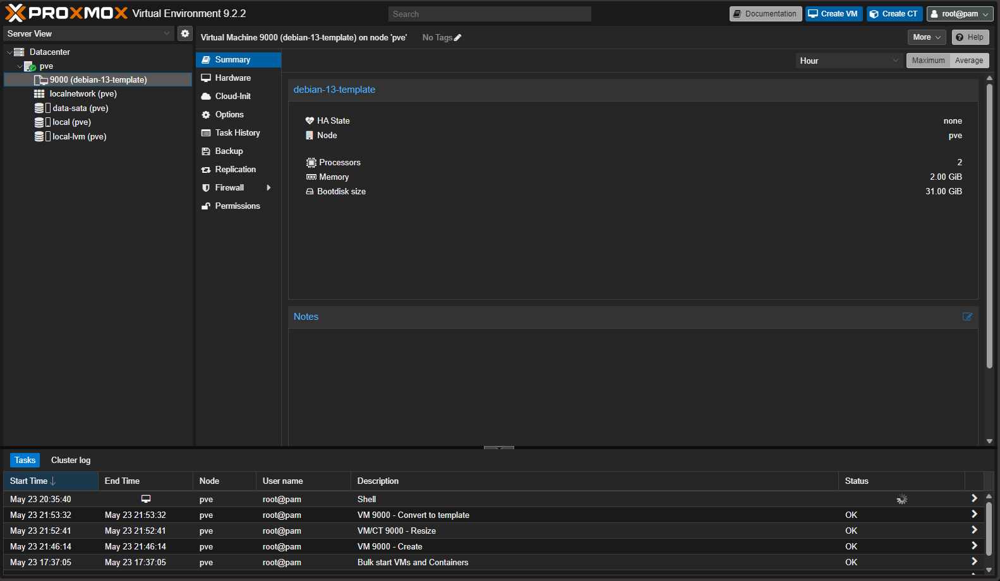
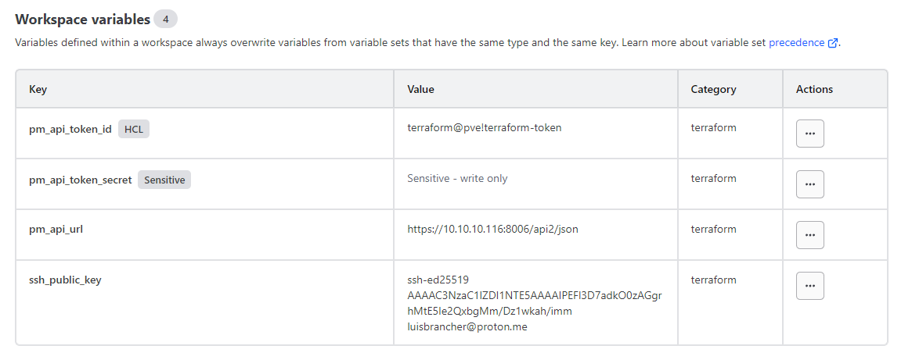
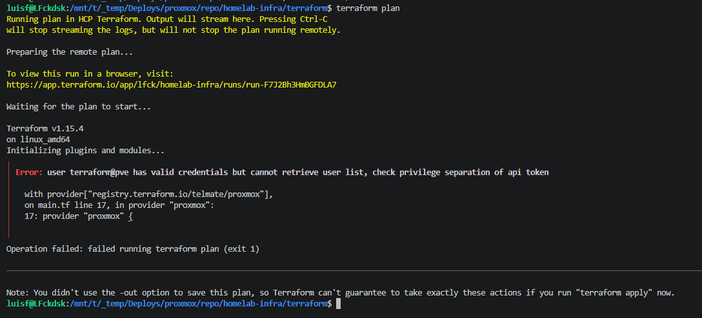
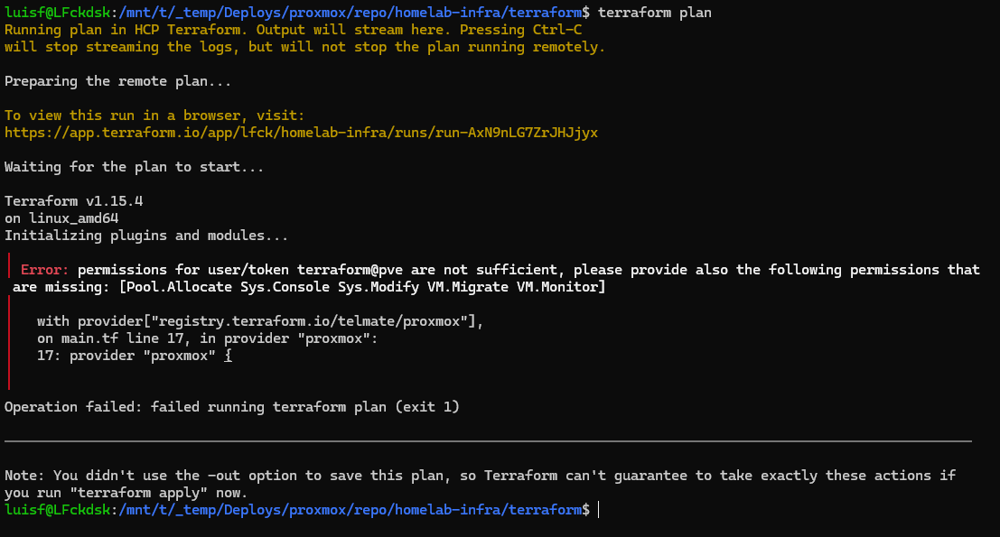
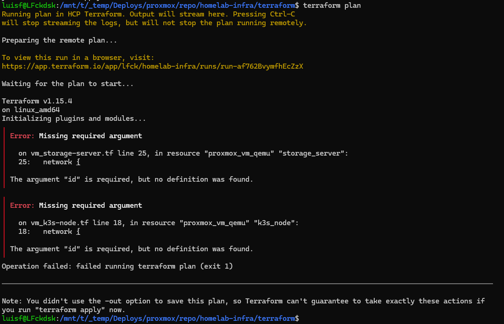
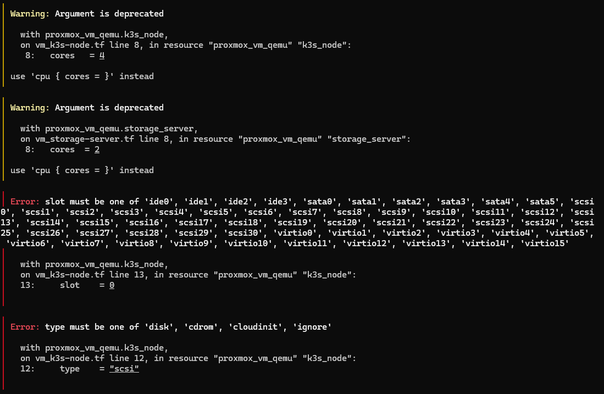
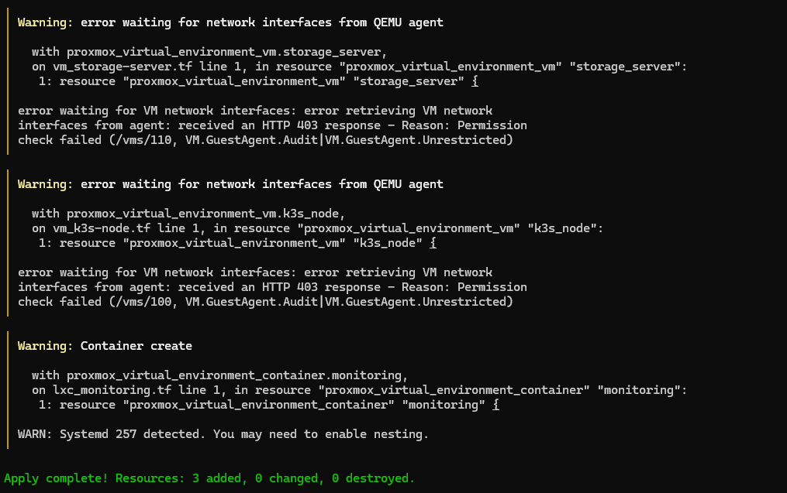
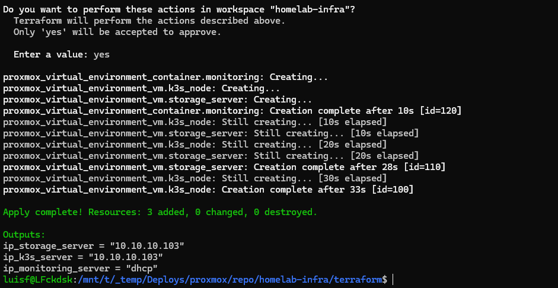

Nos artigos anteriores falei sobre o planejamento, o hardware, como escrevi o código de IaC durante a viagem e a configuração da rede com OpnSense. Esse aqui é diferente: é o primeiro dia com as mãos no hardware de verdade, rodando os comandos, vendo o que quebra e consertando.

Um detalhe de contexto antes: o hardware que eu planejei usar era um i5 1345U fanless que eu tinha em casa. Chegando do Brasil, o mini PC apresentou problemas e tive que mudar de plano. Comprei um Lenovo ThinkCentre pra substituir, mas enquanto ele não chega, resolvi fazer o deploy no Ryzen 5800X que ainda tá de pé. A ideia era rodar tudo no hardware provisório, validar que o código funciona, depurar o que precisar, e quando o Lenovo chegar é só repetir o processo em hardware limpo.

Dois dias depois, aprendi bastante coisa que não estava no plano.

##  Dia 01: Proxmox, storage e preparando tudo pro Terraform

### Instalando o Proxmox

Instalação direta via ISO, sem nada de especial aqui. O Proxmox detectou os discos e configurou o LVM no NVMe principal automaticamente. O que precisei decidir manualmente foi o que fazer com os outros discos.

Meu setup de discos ficou assim:

- **NVMe** (465GB): OS do Proxmox + discos de VM via LVM (`local-lvm`)
- **SATA SSD** (931GB): dados persistentes dos serviços
- **2x HDs SATA** (931GB cada): backups, por enquanto ignorados, depois vão via USB no hardware final

### Configurando o storage do SATA SSD

O SSD veio com dados do ZimaOS anterior. A primeira decisão foi formatar para começar limpo e evitar surpresa.

Escolhi **btrfs** em vez de ext4. Snapshots nativos por subvolume, compressão transparente com zstd e checksumming pra detectar corrupção silenciosa. Pra um disco que vai guardar fotos do Immich e arquivos do Nextcloud faz diferença.

```
mkfs.btrfs -f -L data-sata /dev/sdc
mkdir -p /mnt/data
mount /dev/sdc /mnt/data
```

No fstab usando UUID pra não depender da letra do dispositivo, que pode mudar:

```
echo 'UUID=c0954474-c348-446e-90d7-dbd521e7070e /mnt/data btrfs defaults,compress=zstd,noatime 0 0' >> /etc/fstab
mount -o remount /mnt/data
systemctl daemon-reload
```

Em vez de jogar tudo na raiz do disco, criei subvolumes separados por serviço. Cada subvolume pode ter política de snapshot própria no futuro:

```
btrfs subvolume create /mnt/data/nextcloud
btrfs subvolume create /mnt/data/immich
btrfs subvolume create /mnt/data/upsnap
btrfs subvolume create /mnt/data/backups
```

Depois registrei o disco no Proxmox pra ele aparecer como opção de storage:

```bash
pvesm add dir data-sata --path /mnt/data --content images,rootdir,backup
```

No final ficaram três pools disponíveis:

| Nome | Tipo | Uso |
| --- | --- | --- |
| `local-lvm` | LVM-Thin (NVMe) | Discos de VM e LXC |
| `data-sata` | Directory (btrfs) | Dados persistentes |
| `local` | Directory | ISOs e templates |

### Criando o usuário do Terraform no Proxmox

O Terraform precisa de acesso à API do Proxmox. Uma boa prática é criar um usuário dedicado com só as permissões que ele precisa, sem usar root. Fiz pela UI pra me familiarizar com o Proxmox:

- **Datacenter → Users → Add**: usuário `terraform`, realm `Proxmox VE authentication server`.
- **Datacenter → Roles → Create**: role `TerraformRole` com os privilégios necessários.
- **Datacenter → Permissions → Add → User Permission**: associei a `TerraformRole` ao `terraform@pve` com path `/` e Propagate marcado.
- **Datacenter → Permissions → API Tokens → Add**: token ID `terraform-token`, com **Privilege Separation desmarcado**. Esse detalhe é importante porque com privsep ativo o token fica mais restrito que o usuário mesmo tendo a role correta.

O secret gerado aparece uma única vez. Copiei pro HCP Terraform.

### Criando o VM template (Debian 13 cloud-init)

Fui de Debian 13 Trixie direto, já é stable desde junho de 2025, sem motivo pra usar o 12.

```bash
cd /tmp
wget https://cloud.debian.org/images/cloud/trixie/latest/debian-13-genericcloud-amd64.qcow2
```

Aqui tive uma pausa forçada de 20 minutos. O wget falhou com `Temporary failure in name resolution`. O OPNsense não tinha internet. Tinha mudado ele de lugar antes e o cabo estava mal encaixado. Reconectei os cabos, ping no 8.8.8.8 voltou, wget funcionou. Mas levei um tempinho até perceber que o problema era apenas cabo mal encaixado.

Com a imagem baixada, os passos pra criar o template via CLI:

```bash
# cria a VM base (ID 9000 é convencional pra templates)
qm create 9000 --name "debian-13-template" --memory 2048 --cores 2 --net0 virtio,bridge=vmbr0

# importa o disco pro local-lvm
qm importdisk 9000 /tmp/debian-13-genericcloud-amd64.qcow2 local-lvm

# conecta o disco importado como boot disk
qm set 9000 --scsihw virtio-scsi-pci --scsi0 local-lvm:vm-9000-disk-0

# adiciona o drive de cloud-init, que injeta usuário, SSH key e rede nas VMs clonadas
qm set 9000 --ide2 local-lvm:cloudinit

# configura boot order e serial, necessário pro cloud-init funcionar
qm set 9000 --boot c --bootdisk scsi0
qm set 9000 --serial0 socket --vga serial0

# redimensiona o disco base pra 31GB
qm resize 9000 scsi0 +28G

# converte pra template
qm template 9000
```



### LXC template

Esse não precisa criar, só baixar:

```
pveam update
pveam download local debian-13-standard_13.1-2_amd64.tar.zst
```

### Configurando o HCP Terraform

Criei um projeto `homelab` e um workspace `homelab-infra` no HCP Terraform, com execution mode **CLI-driven** pra rodar via terminal.

Quatro variáveis do tipo Terraform:

| Variável | Sensitive |
| --- | --- |
| `pm_api_token_id` → `terraform@pve!terraform-token` | ❌ |
| `pm_api_token_secret` → secret gerado | ✅ |
| `pm_api_url` → `https://10.10.10.116:8006/api2/json` | ❌ |
| `ssh_public_key` → conteúdo do `id_ed25519.pub` | ❌ |

Um erro que cometi aqui: marquei o `pm_api_token_id` como sem querer HCL. O `!` no valor (`terraform@pve!terraform-token`) quebra o parser HCL. Desmarcando resolve.



### Ajustes no código antes de rodar

O código que escrevi na viagem tinha algumas coisas pra ajustar antes de rodar:

- Migrou auth de user/password pra API token
- Adicionou bloco `cloud {}` apontando pro workspace no HCP
- Corrigiu VMIDs: template é 9000, VMs usam 100, 110, 120
- Adicionou disco de OS explícito em cada VM, o provider não herda do template automaticamente
- Disco de dados da `storage-server`: 800G no `data-sata`
- Atualizado `lxc_template` default pro Debian 13

### O problema do runner na nuvem

Primeiro `terraform plan`, primeiro erro:

```
dial tcp 10.10.10.116:8006: connect: network is unreachable
```

O HCP Terraform roda os plans nos servidores da HashiCorp, que não têm como alcançar `10.10.10.116` da minha rede local.

A solução é o **HCP Terraform Agent**: um processo que roda dentro da sua rede e puxa os jobs do HCP via conexão de saída, sem precisar abrir porta nenhuma.

No HCP: **Settings → Agents → Create agent pool** → `homelab-agent`. Copia o token.

No workspace: **Settings → General → Execution Mode** → Agent → `homelab-agent`.

Rodei o agente via Docker no meu PC:

```bash
docker run -d \
  --name tfc-agent \
  --restart unless-stopped \
  -e TFC_AGENT_TOKEN="TOKEN_AQUI" \
  -e TFC_AGENT_NAME="homelab-agent" \
  hashicorp/tfc-agent:latest
```

Com o agente registrado, o plan passou do erro de conectividade e começou a bater na API do Proxmox de verdade.

### Debugging do plan

Erro 1

```
user terraform@pve has valid credentials but cannot retrieve user list,
check privilege separation of api token
```



Faltava `Sys.Audit` na `TerraformRole`:

```
pveum role modify TerraformRole -privs "Sys.Audit"
```

Erro 2

```
permissions for user/token terraform@pve are not sufficient,
missing: [VM.Monitor]
```



O provider `telmate/proxmox` 3.x ainda exigia `VM.Monitor` que o Proxmox 9 não tem mais. Pesquisando, vi que a versão `3.0.2-rc07` resolve isso e que a comunidade estava migrando em massa pro `bpg/proxmox`. Decidi testar a rc07 primeiro pra fechar o dia.

Erro 3

```
The argument "id" is required, but no definition was found.
```



O provider 3.x mudou a sintaxe do bloco network. Adicionei `id = 0`.

Erro 4

```
slot must be one of 'ide0', 'scsi0'...
type must be one of 'disk', 'cdrom', 'cloudinit', 'ignore'
```



Mais mudança de sintaxe no 3.x: `slot = 0` virou `slot = "scsi0"` e `type = "scsi"` virou `type = "disk"`. Corrigi os dois.

Plan verde. Apply funcionou. As VMs subiram no Proxmox.

O output não retornou IPs porque o provider `telmate` depende do QEMU Guest Agent pra ler o IP, e as VMs clonadas do template não tinham ele instalado. Isso era pra ser resolvido pelo Ansible, mas sem IP o Ansible não conseguiria conectar. Ovo e galinha.

Decidi não perder tempo resolvendo isso no provider antigo, era hora de migrar pro `bpg/proxmox` de qualquer forma.

##  Dia 02: migrando pro bpg/proxmox e consertando o guest agent

### Por que trocar de provider

Depois de dois erros seguidos de compatibilidade com o Proxmox 9 no `telmate/proxmox`, pesquisei e confirmei o que estava vendo nas issues do GitHub: a comunidade migrou pro `bpg/proxmox`. É mantido ativamente, tem suporte nativo ao Proxmox 9 sem gambiarras de permissão e a documentação é bem mais completa.

Valeu manter o `telmate` pra exercitar o troubleshooting, mas sem motivo pra continuar com ele.

Dei destroy nas VMs e comecei a migração.

### As mudanças no código

O `bpg/proxmox` é uma reescrita, não uma atualização. Os nomes dos recursos, atributos e blocos mudaram bastante.

**`main.tf`**: sintaxe de auth completamente diferente. O token vira uma string única no formato `user@realm!tokenid=secret`, e o provider precisa de um bloco `ssh` quando usa API token:

```hcl
provider "proxmox" {
  endpoint  = var.pm_api_url
  api_token = "${var.pm_api_token_id}=${var.pm_api_token_secret}"
  insecure  = true

  ssh {
    agent    = true
    username = "root"
  }
}
```

O bloco `ssh` é necessário porque alguns recursos do provider usam SSH além da API REST. Com `agent = true` usa a chave do SSH agent sem precisar de senha. Por isso copiei minha `id_ed25519.pub` pro Proxmox antes:

```
ssh-copy-id -i /mnt/c/Users/luisf/.ssh/id_ed25519.pub root@10.10.10.116
```

**VMs**: `proxmox_vm_qemu` virou `proxmox_virtual_environment_vm`. Praticamente tudo mudou:

```hcl
resource "proxmox_virtual_environment_vm" "k3s_node" {
  name      = var.k3s_server
  node_name = var.proxmox_node
  vm_id     = 100

  clone {
    vm_id = var.vm_template_id  # número, não string
  }

  cpu {
    cores = 4
    type  = "host"
  }

  memory {
    dedicated = 8192
  }

  disk {
    interface    = "scsi0"
    size         = 50           # número, não "50G"
    datastore_id = var.storage_pool
  }

  network_device {
    bridge = var.network_bridge
    model  = "virtio"
  }

  initialization {
    ip_config {
      ipv4 {
        address = "dhcp"
      }
    }
    user_account {
      keys = [var.ssh_public_key]
    }
  }
}
```

**LXC**: `proxmox_lxc` virou `proxmox_virtual_environment_container`:

```hcl
resource "proxmox_virtual_environment_container" "monitoring" {
  unprivileged = true
  node_name    = var.proxmox_node
  vm_id        = 120

  initialization {
    hostname = var.monitoring_server
    ip_config {
      ipv4 { address = "dhcp" }
    }
    user_account {
      keys = [var.ssh_public_key]
    }
  }

  operating_system {
    template_file_id = var.lxc_template
    type             = "debian"
  }

  features {
    nesting = true
  }
  ...
}
```

O `unprivileged = true` e `nesting = true` vieram do troubleshooting, mais sobre isso abaixo.

**variables.tf**: removi `vm_template` (string com nome) e adicionei `vm_template_id` (number). O `bpg/proxmox` referencia o template pelo ID numérico, não pelo nome.

### Apply e os warnings

O plan funcionou limpo com o novo provider. O apply subiu as 3 VMs/LXC em menos de 30 segundos, mas com 3 warnings.



Warnings 1 e 2

```
Permission check failed (/vms/110, VM.GuestAgent.Audit|VM.GuestAgent.Unrestricted)
```

O `bpg/proxmox` tenta ler o IP via guest agent logo após criar as VMs. A `TerraformRole` não tinha essas permissões:

```
pveum role modify TerraformRole -privs "VM.GuestAgent.Audit VM.GuestAgent.Unrestricted"
```

Warning 3

```
WARN: Systemd 257 detected. You may need to enable nesting.
```

O Debian 13 usa Systemd 257, que precisa de nesting habilitado no LXC pra gerenciar serviços corretamente. Tentei adicionar `features { nesting = true }` no código, mas o apply falhou:

```
Permission check failed (changing feature flags for privileged container
is only allowed for root@pam)
```

Container privilegiado só aceita mudança de features via `root@pam`, não via token da API. A solução é container não privilegiado com `unprivileged = true`, que além de resolver o problema de permissão é a prática recomendada pra segurança em LXC.

### O problema do guest agent no template

O apply estava quase perfeito, mas os outputs das VMs voltavam `127.0.0.1` em vez do IP real. O provider lia o primeiro endereço do guest agent, que é o `lo`, não o `ens18`. Fix simples no `outputs.tf`: `ipv4_addresses[0][0]` virou `ipv4_addresses[1][0]`.

Mas o problema raiz era outro: as VMs só tinham IPs visíveis via guest agent porque o template já vinha com ele instalado. No apply anterior, as VMs não tinham guest agent e os IPs não apareciam em lugar nenhum. Precisava resolver isso no template.

1\. Converter o template de volta pra VM normal:

```bash
qm set 9000 --template 0
```

2\. Clonar pra uma VM temporária:

```bash
qm clone 9000 999 --name "debian-13-temp"
qm start 999
```

3\. O problema ovo-galinha

A VM clonada do template cloud-init não tem senha configurada, só aceita login via SSH key. Mas sem guest agent não tem IP visível, e sem IP não dá pra conectar via SSH. Sem login, sem instalar pacote.

Solução: injetar senha diretamente no disco com a VM parada:

```bash
qm stop 999
apt install -y libguestfs-tools  # no Proxmox host
virt-customize -a /dev/pve/vm-999-disk-0 --root-password password:suasenha
qm start 999
```

4\. Configurar rede manualmente

Logado via console, a interface `ens18` não tinha IP. O cloud-init rodou sem datasource de rede então não criou o arquivo de configuração da interface. Fiz manualmente o que ele faria:

```
cat > /etc/systemd/network/10-ens18.network << 'EOF'
[Match]
Name=ens18

[Network]
DHCP=yes
EOF
systemctl restart systemd-networkd
```

Alguns segundos depois: `10.10.10.103` via DHCP.

5\. Habilitar o guest agent no Proxmox e instalar:

```bash
# no Proxmox host
qm set 999 --agent enabled=1

# dentro da VM
apt update && apt install -y qemu-guest-agent
systemctl start qemu-guest-agent
```

6\. Limpar e converter pra template:

```bash
# dentro da VM
rm /etc/systemd/network/10-ens18.network
cloud-init clean
poweroff

# no Proxmox host
qm destroy 9000
qm clone 999 9000 --name "debian-13-template" --full
qm template 9000
qm destroy 999
```

### Apply final

Com o template correto, o apply final funcionou sem warnings:

```
proxmox_virtual_environment_container.monitoring: Creation complete after 10s [id=120]
proxmox_virtual_environment_vm.storage_server: Creation complete after 26s [id=110]
proxmox_virtual_environment_vm.k3s_node: Creation complete after 27s [id=100]

Apply complete! Resources: 3 added, 0 changed, 0 destroyed.

Outputs:
ip_k3s_server        = "10.10.10.104"
ip_storage_server    = "10.10.10.105"
ip_monitoring_server = "dhcp"
```



Três máquinas rodando, IPs visíveis, pipeline completa funcionando.

### 💡 O que ficou de aprendizado

**Sobre providers**: versão importa. O `telmate/proxmox` funcionava mas estava travado em compatibilidade com o Proxmox 9. Migrar pro `bpg/proxmox` foi a decisão certa e o código ficou mais limpo.

**Sobre cloud-init**: o template cloud-init só configura a rede se tiver datasource. Sem os dados que o Proxmox injeta via cloud-init drive, ele roda mas não faz nada na rede. Importante saber isso quando precisar acessar uma VM clonada manualmente.

**Sobre RBAC**: least privilege na teoria é simples, na prática você vai descobrindo o que falta à medida que os erros aparecem. `Sys.Audit`, `VM.GuestAgent.Audit`, `VM.GuestAgent.Unrestricted` não estavam em nenhum tutorial, todos apareceram no log.

**Sobre HCP Terraform com rede local**: o agent é o caminho certo pra infraestrutura on-prem. Um container Docker pra configurar e você tem um runner dentro da sua rede sem abrir porta nenhuma.

O próximo passo é o Ansible: pegar os IPs que o Terraform gerou, colocar no inventory e rodar os playbooks pra configurar cada VM do zero: k3s, NFS, Tailscale, Prometheus, Grafana, Loki.

O código tá no [homelab-infra](https://github.com/luisbrancher/homelab-infra).
