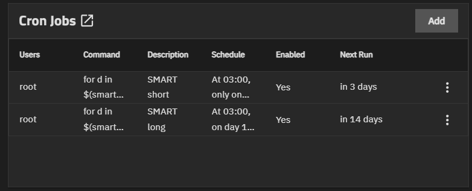

No [post anterior](../revisando-homelab/) contei como cheguei na revisão do homelab e como dividi o trabalho em fases antes da observabilidade. Agora começam as mudanças, e começo pelos discos, que foi onde achei mais coisa funcionando por sorte.

## Pools em stripe e nenhum aviso

Meu NAS tem dois pools ZFS em stripe, com dois discos cada. Sem redundância, por escolha: prefiro o espaço. O preço é que um disco que morre leva o pool inteiro, e eu não tinha nada me avisando. Sem scrub com alerta e sem SMART agendado, a primeira notícia de um disco ruim seria o pool sumir.

O primeiro ajuste foi o mais simples. Criei um bot no Telegram e liguei como serviço de alerta no próprio TrueNAS. Com o nível em Warning, ele cobre falha de replicação, pool degradado, scrub com erro e disco enchendo.

Pros testes de SMART, a minha versão do TrueNAS não mostra o card de Periodic S.M.A.R.T. Tests, então virou Cron Job como root, um short toda quarta e um long todo dia 15:

```bash
for d in $(smartctl --scan | awk '{print $1}'); do smartctl -t short $d; done
```



O cron só dispara o teste, ninguém olha o resultado. Pra isso instalei o Scrutiny, que guarda o histórico de cada disco e manda notificação no mesmo Telegram.

## O SSD de boot que nasceu "Failed"

Na primeira coleta, o Scrutiny marcou o NVMe de boot do TrueNAS como Failed, com 121 Media Errors. São erros de integridade que o controlador não conseguiu corrigir, então não era alarme falso. Levei um susto.

O `smartctl -a` contou uma história mais calma:

| Atributo | Valor |
|---|---|
| Critical Warning | 0x00 |
| Available Spare | 100% |
| Percentage Used | 6% |
| Power On Hours | 12.867 |
| Unsafe Shutdowns | 53 |
| Error Information Log | No Errors Logged |
| Self-test short e long | Completed without error |

Desgaste de 6%, nenhum bloco reserva usado, log de erros vazio e os dois testes passando. Tudo indica que os erros são antigos, provavelmente da vida anterior desse SSD, que é usado. A urgência caiu de "trocar já" pra "acompanhar". O contador nunca volta a zero, então o Scrutiny vai mostrar Failed pra sempre. O que eu preciso olhar é se o número sobe.

Anotei os valores de hoje pra comparar daqui a uma ou duas semanas e fiz backup da config do TrueNAS fora do NAS. Se esse disco morrer, os dados continuam nos pools, mas o NAS para, e com ele o NFS do cluster. Com o arquivo de config, é reinstalar e subir de volta.

## O disco que só estava certo por acaso

Esse aqui me incomodou mais. No playbook do `k3s-node`, o disco de mídia do Jellyfin estava assim:

```yaml
- name: Mount media SSD persistently
  ansible.posix.mount:
    path: /mnt/media-ssd
    src: /dev/sda1
```

Só que na VM o `sda` é o disco do SO. A mídia é o `sdb`. Eu já tinha caído nisso duas vezes e corrigido o fstab na mão, sem levar a correção pro código. Se eu rodasse esse playbook de novo, ele reescreveria o fstab, e no próximo reboot `/mnt/media-ssd` passaria a ser a própria raiz do sistema. O Linux monta o mesmo ext4 duas vezes sem reclamar, e o Jellyfin ia escanear o `/` inteiro.

O código agora usa o caminho `/dev/disk/by-id/`, que vem do slot da VM e não muda quando `sda` e `sdb` trocam de ordem. O mount usa o UUID, lido na hora com `blkid`. Se eu fixasse o UUID no código, recriar a VM quebraria tudo, porque o disco novo teria outro.

Faltava um segundo risco: se o SSD não montar, o Jellyfin escreve na pasta vazia que fica embaixo do ponto de montagem e enche o disco do SO sem ninguém perceber. Dá pra resolver com `chattr +i` nessa pasta, porque aí a escrita falha. O problema é que ela está escondida pelo próprio mount, e eu não queria desmontar nada. O truque foi um bind mount do `/`, que mostra o que tem por baixo:

```bash
tmp=$(mktemp -d)
mount --bind / "$tmp"
trap 'umount "$tmp"; rmdir "$tmp"' EXIT
chattr +i "$tmp/mnt/media-ssd"
```

Sem desmontar nada e sem parar o Jellyfin. A versão no playbook também confere com `lsattr` se a flag já está lá.

A revisão também sugeria um drop-in no k3s com `RequiresMountsFor=/mnt/media-ssd`, e acabei descartando. Sem `nofail` no fstab, a falta do SSD no boot já joga a VM em modo de emergência, então ali ele não acrescenta nada. Depois do boot, uma falha nesse disco derrubaria o k3s inteiro, Immich e Nextcloud juntos, por causa de um disco com filme. Não valia a troca.

### Rodar de novo é o teste

Fui rodando com `--check --diff` antes de aplicar, e isso pegou dois problemas.

O primeiro veio já na simulação: a task do ponto de montagem ia mudar a permissão de 775 pra 755. É que `/mnt/media-ssd` são duas pastas no mesmo caminho, a vazia do SO e a raiz do SSD por cima, e a task via a de cima. O `mode: '0755'` do código não batia com o que eu tinha deixado na máquina. Mais um drift. Tirei o `mode`, já que a task só precisa garantir que a pasta existe.

O segundo foi depois de aplicar. A segunda execução tinha que dar `changed=0` e deu `changed=1`. O bug estava nessa linha, que o Claude escreveu e eu aprovei sem perceber:

```yaml
changed_when: "'changed' in media_ssd_immutable.stdout"
```

O script imprime `changed` ou `unchanged`, e `unchanged` contém `changed`. A VM estava certa, só o relatório mentia. Um `changed` que aparece sempre não quebra nada hoje, mas me ensinaria a ignorar esse aviso. Trocar por `== 'changed'` resolveu, e a execução seguinte deu `changed=0`.

## 48GB presos no thin pool

Os dois discos da VM ficam em LVM-Thin, com `discard=ignore`. Eu li isso errado na primeira vez: achei que a VM não sabia o que tinha sido apagado e que a gente ia corrigir só o número mostrado. É o contrário. A VM sabe, e o `df` está certo. Quem não fica sabendo é o Proxmox, porque o aviso de "esses blocos estão livres" morre no caminho. O bloco continua ocupado no SSD físico.

No fluxo do Jellyfin, de baixar, assistir e apagar, o pool só cresce. Quando chega em 100%, a VM trava com erro de I/O, mesmo achando que tem espaço de sobra.

O ajuste no Terraform é pequeno:

```diff
   disk {
     interface    = "scsi1"
     size         = 220
     datastore_id = "media-ssd"
+    discard      = "on"
+    ssd          = true
   }
```

O `apply` não bastou, e isso eu não sabia. O Proxmox gravou a configuração nova e a VM seguiu rodando com a antiga:

```text
cur scsi1: media-ssd:vm-100-disk-0,...,discard=ignore,...,ssd=0
new scsi1: media-ssd:vm-100-disk-0,...,discard=on,...,ssd=1
```

Um reboot de dentro da VM também não resolve, porque o processo do QEMU continua o mesmo. Precisa desligar e ligar pelo host:

```bash
qm shutdown 100 --timeout 180 && qm start 100
```

Depois disso, o `discard` só cuida do que for apagado dali pra frente. Na VM, o `/` já monta com `discard`, mas a mídia depende do `fstrim.timer` semanal, que deixei garantido no Ansible. Pro que já estava preso, rodei `fstrim -av` na VM e `pct fstrim 120` no host pra LXC de monitoramento, já que contêiner não recebe `discard` como VM. O resultado no `lvs`:

| Volume | Antes | Depois | Devolvido |
|---|---|---|---|
| SO da VM (50G) | 98,73% | 56,39% | ~21GB |
| Mídia da VM (220G) | 19,95% | 8,07% | ~26GB |
| LXC de monitoramento (20G) | 31,07% | 25,83% | ~1GB |

Quase 48GB, sem sintoma nenhum até eu olhar. O `fstrim` chegou a dizer "202,2 GiB trimmed" na mídia, mas esse número é todo o espaço livre avisado, inclusive o que nunca foi usado. O ganho de verdade é a queda no `lvs`.

Nessa saída apareceu outra coisa: o disco virtual da mídia tem 220G e o pool que hospeda ele tem 218,97G. Se eu encher a mídia de verdade, o pool acaba antes do sistema de arquivos. Anotei pra não passar de uns 200G.

## Quanto disco o SO precisa

O disco do SO estava em 59%, e nove dias antes estava em 49%. Minha ideia era aumentar bastante, já que os dados moram no TrueNAS e esse disco seria só de sistema. Fui medir antes:

| O que ocupa | Tamanho |
|---|---|
| Imagens de container | 19G |
| Logs do journal | 3,9G |
| Dados dos pods | 2,9G |
| Bancos do Immich e do Nextcloud | 1,6G |

Não era só sistema. Os bancos moram aqui, e as imagens são o que mais cresce. Fiquei em 100G, e não em 150G, por dois motivos. O k3s só limpa imagem antiga perto de 85% de uso, então um disco maior acumula mais lixo antes de limpar. E 150G faria a soma dos discos virtuais passar do tamanho do pool. O Proxmox só cresce disco, nunca reduz, e crescer de novo leva poucos minutos, então não tem por que exagerar agora.

Crescer são três camadas, e cada uma tem o seu comando:

```bash
terraform apply                   # disco virtual
sudo growpart /dev/sda 1          # partição
sudo resize2fs /dev/sda1          # sistema de arquivos
```

Antes de rodar, o `growpart --dry-run` mostrou que o início da partição e o UUID não mudavam. Foi tudo com a VM ligada, sem queda de serviço, e o `/` foi de 59% pra 30%.

## O que ficou aberto

Ainda preciso comparar os contadores do SSD de boot com os valores anotados, agendar o `pct fstrim` da LXC e mover a biblioteca do Jellyfin pra uma subpasta, porque hoje ela aponta pra raiz do volume.

### 💡 O que ficou de aprendizado

**Sobre SMART**: teste que ninguém olha não avisa nada, e um Failed sozinho não é diagnóstico. Os 121 Media Errors me assustaram, mas o que vou acompanhar é se o contador sobe.

**Sobre drift**: correção feita na mão e não levada pro código continua sendo um problema, só que escondido. O fstab estava certo na máquina e errado no playbook, e a próxima execução desfaria o conserto.

**Sobre idempotência**: `--check --diff` antes e uma segunda execução depois pegam coisas diferentes. A simulação achou a permissão que ia mudar, e a segunda execução achou o `changed_when` que mentia.

**Sobre thin provisioning**: o `df` da VM não diz quanto o pool está ocupando, quem mostra isso é o `lvs`. E o `discard` novo só valeu depois de desligar e ligar a VM pelo host.

**Sobre dimensionar disco**: medir antes mudou a decisão. Eu achava que o disco do SO era só de sistema, mas os bancos moram ali. Como dá pra crescer depois e não dá pra reduzir, fiquei com o menor tamanho que resolvia.
